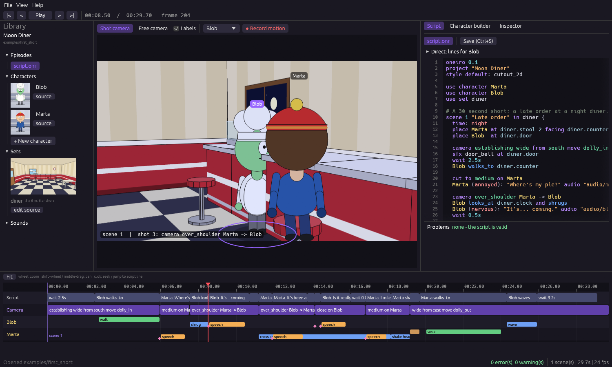

# Oneiro

> A language and studio for making consistent, character-driven animated series — written by humans, directed by AI.

Oneiro is **not** a motion-graphics tool and **not** an AI video generator. A scene is a *model of a world*
(characters, sets, props, cameras, dialogue, state) and a **style** decides how it looks. Characters are data,
so they never drift between shots or episodes.

```
scene 1 "Late order" in diner {
  time: night
  place Marta at diner.stool_2 facing diner.counter
  place Blob  at diner.door

  camera establishing wide from south move dolly_in for 4s
  Blob walks_to diner.counter

  cut to medium on Marta
  Marta (annoyed): "Where's my pie?" audio "audio/marta_01.wav"

  camera over_shoulder Marta -> Blob
  Blob looks_at diner.clock and shrugs
}
```

## Status: Phases 0-4 done (language, CLI renderer, IDE, AI integration, audio studio)

- **Language + CLI:** parser, solver, CPU renderer, lipsync and mp4 export in the `cutout_2d` (South Park-like) style, on CPU only.
- **Oneiro Studio (IDE):** live viewport, script editor with diagnostics, timeline, library, block-based character builder,
  motion recording and no-code pinning of cameras and placements — see [docs/05-ide.md](docs/05-ide.md).

- **AI integration:** a director that writes and fixes scripts with the engine as judge (Claude Code or Codex under your own login, Anthropic API, local OpenAI-compatible servers), an AI tab with diff and undo, and an **MCP server** so external agents can drive Oneiro and see their own work. See docs/06-ai.md.

- **Audio studio:** record or import voices, generate them with Windows speech / ElevenLabs / local TTS servers, built-in SFX and music generators, music that loops and ducks under dialogue, synchronized playback in the IDE. See [docs/07-audio.md](docs/07-audio.md).

Next: more styles (Phase 5), the hybrid cutter, then 3D. See [docs/04-roadmap.md](docs/04-roadmap.md).



## Quick start

Requirements: Rust (stable) and [ffmpeg](https://ffmpeg.org) on PATH for mp4 export.

```
cargo build --release
./target/release/oneiro check  examples/first_short          # validate (add --json for tools/AI)
./target/release/oneiro render examples/first_short -o out/first_short.mp4
./target/release/oneiro render examples/first_short --preview   # 640x360 fast preview
./target/release/oneiro still  examples/first_short --time 8.5 -o frame.png
./target/release/oneiro demo-audio examples/first_short     # placeholder voices for a new script
./target/release/oneiro voice examples/first_short --provider sapi   # synthesize missing voices (offline on Windows)
./target/release/oneiro sound music cheerful examples/first_short --as bgm   # royalty-free music loop
./target/release/oneiro mix examples/first_short            # final soundtrack + levels
./target/release/oneiro vocab                                # everything the language accepts
cargo test --release

# The studio (IDE): viewport, editor, timeline, library, character builder, record motion
cargo run --release -p oneiro-ide -- examples/first_short
```

`render` also writes `script.onlock` (resolved camera/placement coordinates; set `pinned: true` to keep a hand-edited
value) and `state.out` (story state).

## Core ideas

1. **Separate "what happens" from "how it looks".** One script renders in any style; styles are assigned per character
   so a clay character can talk to a rubber-hose one (planned).
2. **Semantic first, numbers last.** `Marta stands beside the counter`, `medium shot on Marta`. A solver resolves
   coordinates and applies cinematography rules (shot sizes, 180° rule, eyeline-matched over-the-shoulder shots).
3. **AI-first, human-correctable.** Strict language, structured diagnostics with suggestions and fixes, a generated
   vocabulary file; the IDE lets a non-coder fix anything visually (drag, record, pin).
4. **Fast and light.** Rust, deterministic CPU renderer (1080p at 3x realtime on a single core), GPU optional later.
5. **Vertical slices.** Every phase ships something that runs end to end.

## Docs

| Doc | Content |
|---|---|
| [docs/01-language-spec.md](docs/01-language-spec.md) | Syntax, vocabulary, cameras, state, diagnostics |
| [docs/02-formats.md](docs/02-formats.md) | Characters, sets, project layout, lock file |
| [docs/03-architecture.md](docs/03-architecture.md) | Crates, renderers, AI/provider layer, audio |
| [docs/04-roadmap.md](docs/04-roadmap.md) | Phases, results, limitations |
| [docs/05-ide.md](docs/05-ide.md) | Oneiro Studio: layout, workflows, record motion, pinning |
| [docs/06-ai.md](docs/06-ai.md) | AI director, providers, MCP server, what was verified |
| [docs/07-audio.md](docs/07-audio.md) | Audio studio: voices, SFX, music, mixing, IDE tab, commands |
| [examples/first_short/](examples/first_short/) | The Phase 1 example project |

## File extensions

`.onr` script · `.onchar` character · `.onset` set · `.onlock` resolved layout (`.onstyle`, `.onclip` planned)

## License

MIT OR Apache-2.0
