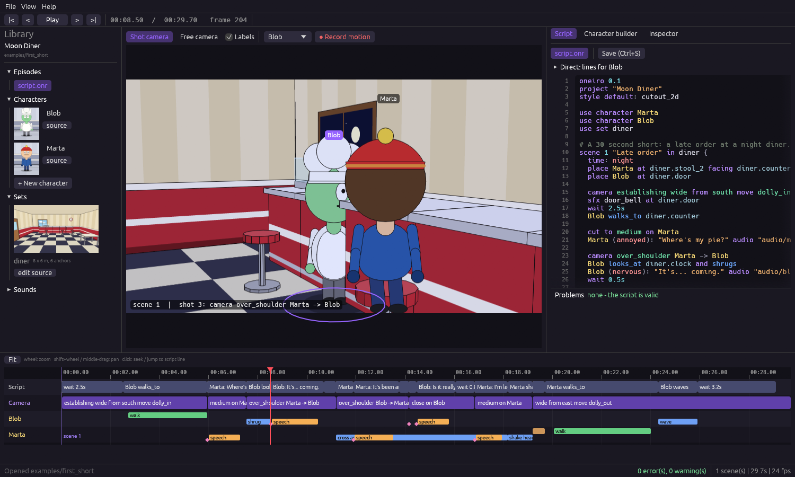
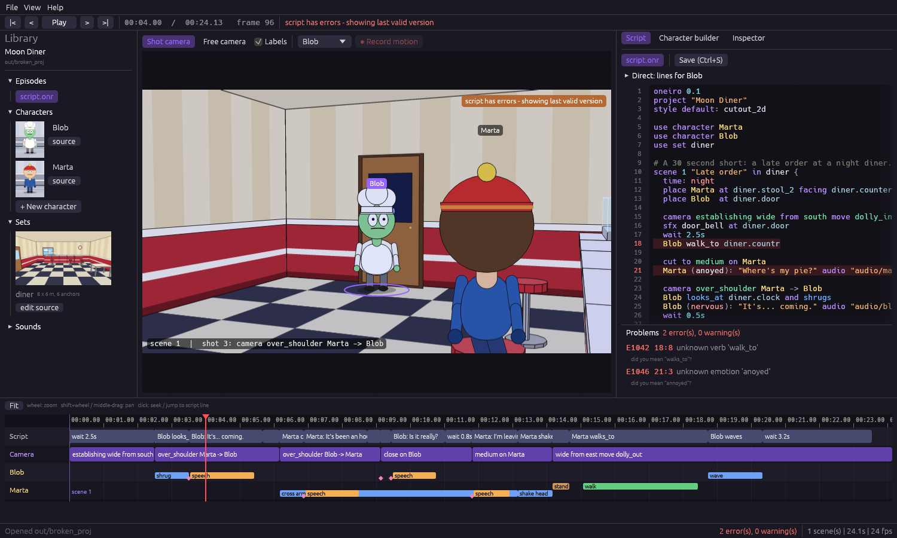
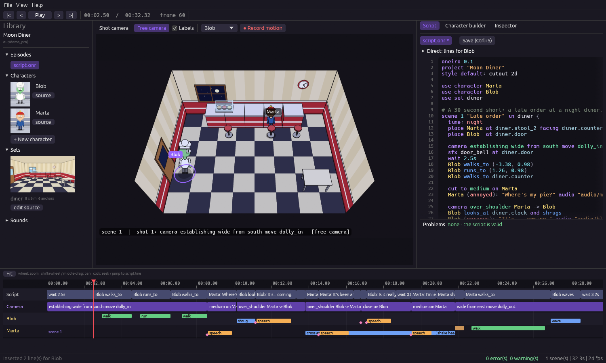
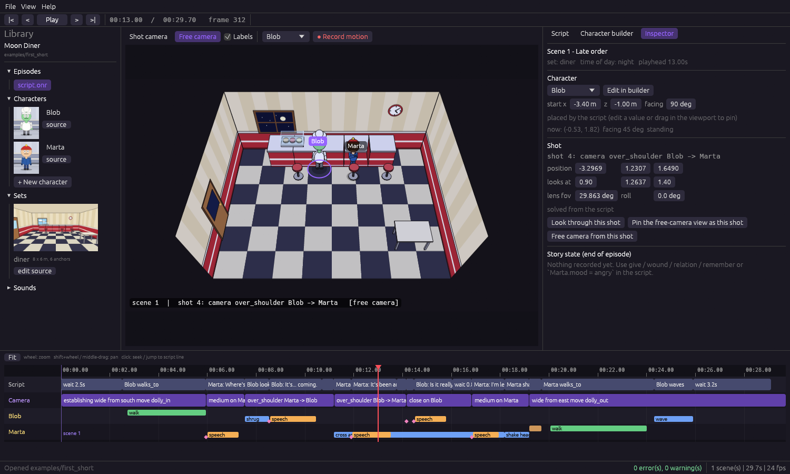
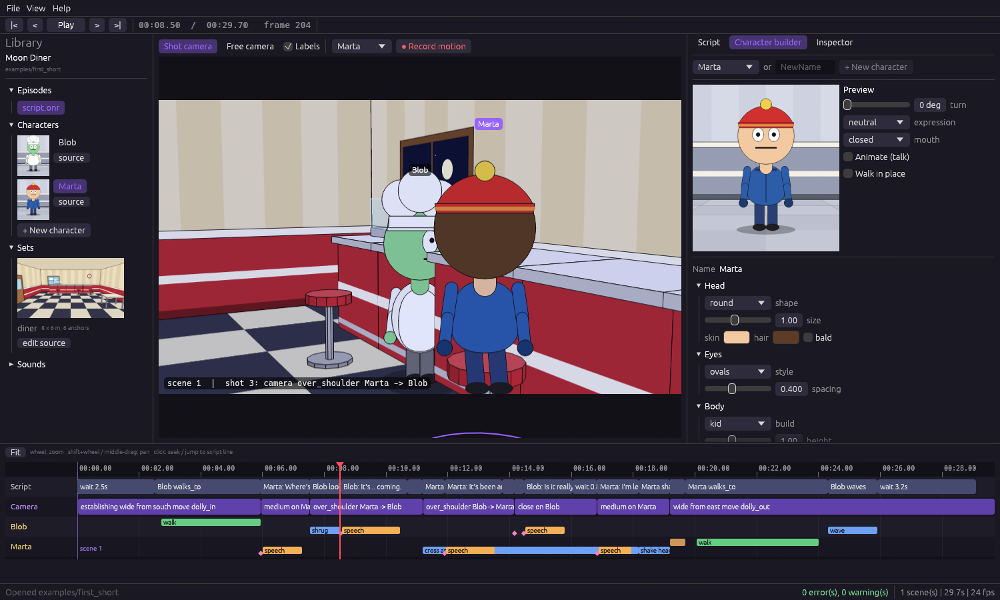

# Oneiro Studio (IDE) — Phase 2

Run it:

```
cargo run --release -p oneiro-ide -- examples/first_short
```

Or start without arguments and use **File > Open project...**. It is one native window (egui over wgpu, so it also
runs on machines without a dedicated GPU). The viewport uses the **same renderer as the mp4 export**, so what you
see is what you get.



## Layout

| Area | What it does |
|---|---|
| **Viewport** (center) | Live render of the current frame. *Shot camera* shows the director's camera; *Free camera* lets you look around (right-drag orbit, middle-drag pan, wheel zoom). Click a character to select it; drag it to move its starting position. |
| **Library** (left) | Episodes, characters (with portraits), sets (with previews), sounds. Click a character to edit it, an episode to open it, "source" to edit the text file. |
| **Script / Character builder / Inspector** (right) | The editor, the block-based character builder and the shot/placement inspector. |
| **Timeline** (bottom) | One row for the script, one for cameras, one per character (walks, sits, gestures, speech, expressions). Scrub, zoom, and click blocks to jump to the script line that made them. |
| **Transport** (top) | Play/pause, frame stepping, time and frame counter. |

## Editing the script

- Syntax highlighting, line numbers, and **live diagnostics**: the script is recompiled 350 ms after you stop typing.
  Errors tint the line red and appear under the editor with their suggestion (`did you mean "walks_to"?`); click one to jump to it.
  While the script has errors the viewport keeps showing the last valid version.
- **Direct** palette (collapsible, above the editor): click a verb, a camera shot or move, an expression, `wait`,
  `together`... and a ready line is inserted for the selected character at the end of the scene (or after the cursor
  line when it is inside a scene). It uses real anchors and characters from the current set.
- Ctrl+S saves everything. Library files (`.onchar`, `.onset`) open as extra tabs; saving them reloads the project.
- Optional *Playhead follows editor cursor* (View menu).



## Record motion (puppeteering)

1. Select a character (viewport combo or click it), move the playhead after the statement you want to follow.
2. **● Record motion** — the camera switches to an overview; the world freezes and only that character moves.
3. Drive it with **WASD / arrow keys** (relative to the camera), **Shift** to run. **Esc** cancels.
4. **Stop**: the path is simplified and shown as script lines. **Insert into script** puts them after the statement
   you recorded against, and the timeline updates immediately.

```
Blob walks_to (-3.38, 0.98)
Blob runs_to (1.26, 0.98)
```

Floor points `(x, z)` are now valid targets for `walks_to`, `runs_to`, `turns_to`, `looks_at` and `points_at`, so recorded
movement is plain, readable, editable script — nothing hidden.



## Pinning: fixing things without code

Everything the solver decides can be overridden visually and is stored in `<script>.onlock` with `pinned: true`:

- **Drag a character** in the viewport (or edit *start x / z / facing* in the Inspector) → pins its starting placement.
- **Inspector > Shot**: edit position, target, lens and roll of the selected shot, or orbit with the free camera and press
  *Pin the free-camera view as this shot*. *Unpin* returns the shot to the solver.
- Pinned values survive recompiles and reopening the project; if the script line behind a pinned shot changes, a
  warning (`W3001`) tells you.



## Character builder

Pick a library character or create a new one (`NewName`, capital letter). Everything is assembled from blocks:
head shape/size/skin/hair/bald, eye style and spacing, body build/height/width, a wardrobe slot per piece
(hat, top, bottom, shoes, accessory), voice pitch, traits and notes for the AI. The preview turns 0–180°, shows any
expression and mouth shape, can talk (cycles visemes) and walk in place. **Save to library** writes
`library/characters/<Name>.onchar` and every open scene updates.



**Style** (per character): `(episode default)`, `cutout_2d`, `rubber_hose` or `clay`; the preview shows it. Characters drawn from
vector parts show a note and keep their own proportions. In the AI tab, *Design a character* has a *Draw it as vector parts (SVG)*
option; the proposal is saved to the library with its SVG files (see [08-styles.md](08-styles.md)).

## Rendering from the IDE

**File > Render mp4** (preview 640x360, HD 720p or Full HD 1080p) renders in a background thread with a progress bar
and a Cancel button, using the same parallel encoder as `oneiro render`.

## Startup switches (for documentation and tests)

`oneiro-ide PROJECT [--time S] [--tab script|character|inspector] [--select NAME] [--free] [--size WxH]`
`[--screenshot out.png [--after FRAMES] [--exit]] [--demo-record] [--demo-insert "Marta waves"] [--export out.mp4]`

`--demo-record` drives a scripted recording and inserts the result; `--export` renders a preview mp4 and quits. The
screenshots in this document were taken with these switches.

## Known limitations

- No audio playback in the IDE yet (the sound studio is Phase 4); the timeline shows speech blocks but you hear them
  after rendering.
- Undo/redo is the text editor's own; pins can be undone with *Unpin*, recorded takes with the editor's undo.
- Library files are saved explicitly (Ctrl+S); the character builder saves its own file when you press Save.
- Dragging an actor edits its **starting** placement; moving it over time is done with `walks_to` (or by recording).
- The viewport's actor picking and dragging, timeline clicks and the builder widgets were verified through their
  underlying logic (unit tests: ground-ray picking, pins round-trip, scene-aware insertion, serialization) and
  screenshots of the running app, not by automated mouse clicks.
