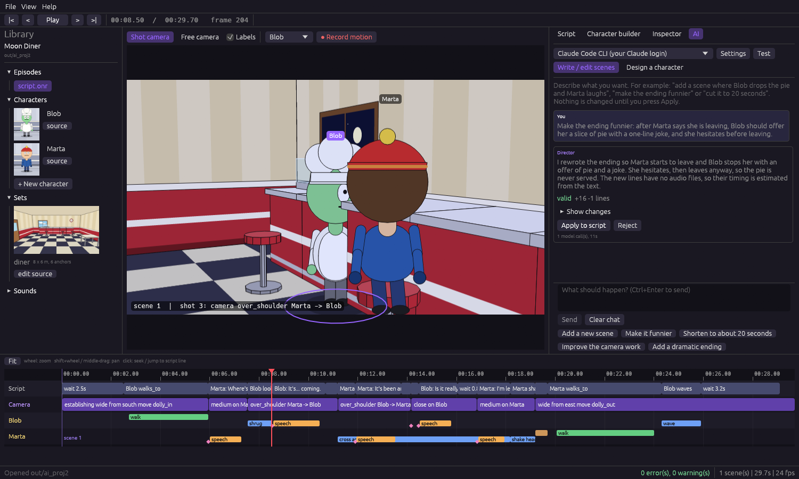

# AI integration — Phase 3

Oneiro is designed so an AI can use it **100% on its own** while a person reviews and corrects without coding.
Three ways to use it, all backed by the same engine:

| Way | What it is | Use it when |
|---|---|---|
| **AI tab in the IDE** | Chat with a "director": describe a scene or a character, review a diff, press Apply. | You want to direct with words and review visually. |
| **`oneiro ai` (CLI)** | The same director from a terminal. | Scripting, batch work. |
| **`oneiro-mcp` (MCP server)** | Lets Claude Code, Codex or any MCP client drive the project with real tools (validate, look at frames, save). | You already work inside an agent and want it to use Oneiro. |



## The principle: the model never gets the last word

Every answer is compiled by the real engine before you see it. If it has errors, the diagnostics (code, line,
suggestion, JSON) go back to the model for correction, up to N rounds. Only valid scripts are offered, as a **diff** you
can apply or reject, and applying is undoable (*Undo AI change*). Optionally the model also **looks** at the result: a
contact sheet with one frame per shot is attached and the model fixes framing problems (needs a provider with image
support).

## Providers (pick one in the AI tab or with `--provider`)

| Provider | How it connects | Credentials | Verified |
|---|---|---|---|
| `claude-cli` | Runs your installed **Claude Code** (`claude -p`, tools disabled, scratch folder) | Your own Claude login; Oneiro never sees it | Real end-to-end runs |
| `codex-cli` | Runs your installed **Codex** (`codex exec`, read-only sandbox, can attach images) | Your own Codex login | Real connection test; same director code path as Claude |
| `anthropic` | Anthropic Messages API (default model `claude-sonnet-5-5`), supports images | API key from an environment variable (default `ANTHROPIC_API_KEY`) or pasted for the session | Request/response shapes against a local mock server (no key was available) |
| `openai` | Any OpenAI-compatible `/chat/completions`: OpenAI, **Ollama** (`http://localhost:11434/v1`), LM Studio, llama.cpp, vLLM, OpenRouter... | Optional key from an environment variable | Against a local mock server (no local model was available) |
| `custom-cli` | Any command that reads the prompt on stdin and prints the reply | Whatever the command uses | Against a test agent |

**Credentials.** API keys are never written to disk: the settings file stores only the *name* of the environment
variable. The CLI bridges run the official CLIs under your own login; Oneiro does not read, store or forward
subscription tokens. Check each vendor's current terms of service before redistributing a product built on this.

Settings live in `%APPDATA%\oneiro\ai.conf` (or `~/.config/oneiro/ai.conf`); `--save-config` stores the flags you pass.

## Using it

```
oneiro ai-test --provider claude-cli                        # one tiny request to verify the connection
oneiro ai examples/first_short "make the ending funnier"     # shows the proposed script
oneiro ai examples/first_short "..." --apply                 # writes it (keeps script.onr.bak)
oneiro ai examples/first_short "a grumpy old baker named Pop" --character --apply
oneiro ai examples/first_short "..." --provider openai --base-url http://localhost:11434/v1 --model llama3.1
oneiro ai examples/first_short "..." --provider anthropic --self-check
oneiro guide examples/first_short                            # writes docs/ai/guide.md
```

In the IDE: **AI** tab → pick the provider (Settings for model / URL / key variable) → *Test* → type a request.
The Problems panel has **Fix with AI** when the script has errors. The tab also has *Design a character*: the proposal
opens in the Character builder as an unsaved draft.

## What the model reads

`oneiro guide` / the MCP tool `get_guide` return the same document the director uses as its system prompt:

- the **language guide** (shape of a script, rules, directing advice, common mistakes) with a complete example,
- the exact **vocabulary** (`oneiro vocab`), including which verbs exist but are *not available yet*,
- a **library summary**: every character (build, wardrobe, traits, notes), every set with its **anchors** and
  coordinates, and the available sounds,
- your **project notes**: every `docs/ai/*.md` (series bible, style guide), so the AI stays in character.

## MCP server

`oneiro-mcp PROJECT` speaks MCP (JSON-RPC over stdio). Register it:

```
claude mcp add oneiro -- /path/to/oneiro-mcp /path/to/project
codex  mcp add oneiro -- /path/to/oneiro-mcp /path/to/project
```

(or use the project's `.mcp.json`; the IDE's AI settings have a *Copy MCP setup command* button.)

| Tool | What it does |
|---|---|
| `get_guide` | Language guide, vocabulary, library, notes — call it first |
| `read_script` / `write_script` | Read; validate-then-save the complete script (rejects errors, keeps `.bak`) |
| `check_script` | Structured diagnostics + summary (scenes, duration, shots), for saved or unsaved text |
| `describe_timeline` | Statements and shots with times and lines |
| `render_still` / `contact_sheet` | **Returns images** so the agent can see framing, expressions, who is visible |
| `render_video` | mp4 (preview by default) |
| `list_library` / `write_character` | Inspect the library; validate and save a new character |
| `write_character_parts` | Validate and save a character DRAWN as four SVG parts (Phase 5): every problem is returned so the agent can fix and retry |

Tools read the project from disk on every call. The IDE watches the script file: if an agent saves a change while the IDE
is open, the IDE reloads it (or warns if you have unsaved edits), so you and the agent never diverge.

## What was verified

- **Real runs, on this machine:** the `claude` and `codex` bridges answer; `oneiro ai` and the IDE AI tab produced valid
  scripts with Claude in one round (it respected the vocabulary, for example replacing a non-existent `sighs` with
  `emote sad`). Claude Code, used as an **MCP client** against `oneiro-mcp`, listed and called the tools, **saw the contact
  sheet**, and in a separate run wrote, validated, looked at and saved a second scene on its own (scene 1 untouched, `.bak` kept).
- **Automated tests:** the validate-and-retry loop, history, diff, visual self-check (with and without image support),
  the character design loop, HTTP request/response shapes against mock servers, the CLI bridge against a test agent, every
  tool, MCP in-process and over stdio, external-edit detection, and the solver fixes found during the real runs.
- **Not verified with a real service:** the Anthropic API and OpenAI-compatible providers (no key or local model was
  available here, so only mock servers), the visual self-check with a real vision model, and Codex as an MCP client.

## Fixes the real runs forced (now covered by tests)

- Windows npm shims: `codex` resolved to the extensionless shell shim instead of `codex.cmd`.
- `place X at <solid anchor>` (the AI wrote `place Blob at diner.counter`) put the character inside the counter; it now stands
  in front of it, facing it.
- A close-up of a lone character was framed from behind when they faced away from the camera; it is now framed from the front.

## Limits

- One request replaces the *whole* script (simple and robust); very long scripts cost more tokens.
- Calls are blocking, not streamed; the UI shows progress per round.
- The director follows the engine's vocabulary; anything the engine cannot express yet (picking up objects, transitions)
  is refused with a clear message instead of being faked.
