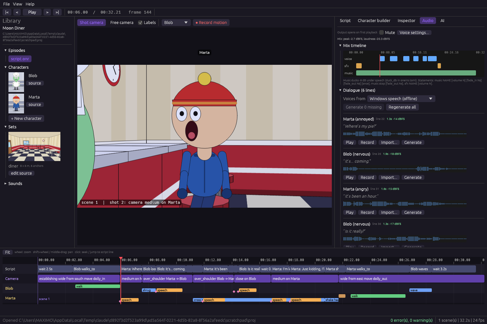

# Audio studio (Phase 4)

Voices, sound effects and music, from the command line, the IDE and AI agents. Everything ends up as plain WAV
files in the project and as three kinds of statements in the script, so a project stays readable and diff-able.

```
music cheerful_1 volume 0.5 fade_in 2s        # loops until stopped, replaced, or the episode ends
Marta (annoyed): "Where's my pie?" audio "audio/marta_01.wav"
sfx door_bell at diner.door volume 0.8
music stop fade_out 2s
```

## Language

| Statement | Meaning |
|---|---|
| `sfx NAME [at ANCHOR] [volume N]` | Plays `library/sounds/NAME.wav` now (default volume 0.7). |
| `music NAME [volume N] [fade_in Ns] [fade_out Ns] [once]` | Starts `library/music/NAME.wav` (default volume 0.4). It **loops** until it is stopped, replaced or the episode ends; `once` plays it a single time. A new `music` crossfades the previous track using that track's `fade_out` (default 1 s). |
| `music stop [fade_out Ns]` | Fades the current music out starting now (default 1 s). |
| `Name (emotion): "text" audio "path.wav"` | The line lasts as long as its audio. Lipsync is computed from that final audio. |

`sfx ... at ANCHOR` is accepted by the language but does not change the sound yet: the soundtrack is mono, there is no panning.

### Mixing

The final soundtrack is `voices + sfx + music` with:

- **Ducking:** while anyone speaks, the music drops by `duck_db` (default `-9`, attack 120 ms, release 600 ms). Set
  `duck_db = 0` in `oneiro.toml` to turn it off, or a different number to change it.
- **Soft limiter** on the master (ceiling about -0.2 dBFS) so overlapping sounds never clip hard. When it has to work,
  `oneiro mix` and the IDE tell you to lower some `volume` values.
- 48 kHz mono, 16-bit WAV inside the project; the mp4 gets the same mix.

## Voices

A character picks its engine in `voice { ... }`:

```
voice { provider: elevenlabs, voice: "21m00Tcm4TlvDq8ikWAM", speed: 1.0, pitch: 235 }
```

| Engine | What it is | Needs |
|---|---|---|
| `file` | Recorded or imported audio only (default) | nothing. When you ask to *generate*, the default engine from the voice settings is used |
| `demo` | Built-in formant babble, instant, for previews | nothing |
| `sapi` | Windows built-in speech (offline) | Windows. `voice:` is a voice name (`oneiro voices sapi`) |
| `elevenlabs` | ElevenLabs cloud voices | an API key in an environment variable (`ELEVENLABS_API_KEY` by default) and a `voice:` id (`oneiro voices elevenlabs`) |
| `openai` | Any OpenAI-compatible `/audio/speech` server: OpenAI, Kokoro-FastAPI, openedai-speech, LocalAI... | base URL (and a key if the server wants one) |
| `command` | Your own program: Piper, espeak-ng, Coqui, a script | a template such as `piper --model voice.onnx --output_file {out}`; placeholders `{text}` `{out}` `{voice}` `{speed}`; without `{text}` the line goes to stdin |

`speed` (0.5 - 2.0) is honored by every engine. `pitch` only matters for `demo`; real engines pick the pitch through the
voice. Lines are sent to ElevenLabs with settings that follow the emotion (an `angry` line is delivered less stable and
more expressive than a `neutral` one).

Settings shared by all projects live in `%APPDATA%\oneiro\voice.conf` (edited from **Audio > Voice settings** or by
hand). **API keys are never written to disk**: the file stores only the *name* of the environment variable, and the IDE
can take a key for the current session only.

Every synthesized or imported voice goes through the same cleanup: DC offset removed, 80 Hz rumble filter, silence
trimmed at both ends, short fades and leveling to about -20 dBFS (speech-gated RMS), so voices from different engines
sit at the same level in the mix.

### Generating the voices of a script

`oneiro voice <project>` finds every dialogue line without an audio file, synthesizes it with that character's voice,
saves `audio/<name>_NN.wav` (never overwriting anything) and writes the `audio "..."` clause into the script. Running it
again changes nothing. A line whose clause points to a missing file is regenerated at that path.

```
oneiro voice examples/first_short --dry-run              # what would be generated
oneiro voice examples/first_short --provider sapi        # offline, uses Windows voices
oneiro voice examples/first_short --only Marta --force   # regenerate one character's lines
oneiro voices elevenlabs                                 # list voice ids
```

## Sounds and music

No external assets are needed: the studio ships generators, all synthesized from scratch (so there are no licenses
to worry about).

- **24 sound effects:** `door_bell ding knock thud punch click pop whoosh boing buzzer splash crash footstep sparkle
  wah_wah slide_up slide_down honk zap coin phone_ring clock_tick scratch applause` (the `seed` varies the details).
- **Music loops** in five moods: `cheerful calm tense quirky sad`, with tempo, length in bars, key and seed. They are
  seamless: the tail of the last bar wraps to the start.

```
oneiro sound sfx --list
oneiro sound sfx boing examples/first_short --as bounce
oneiro sound music quirky examples/first_short --as bgm --bars 8 --bpm 128 --seed 3
```

### Importing

`oneiro import <project> <file> --kind voice|sfx|music|raw [--as NAME]` converts any common format (wav, mp3, ogg, flac,
m4a, aac, opus, audio of a video; everything but WAV needs `ffmpeg`) to the project's 48 kHz mono WAV and processes it
by kind: *voice* = the cleanup above, *sfx* = trim silence + normalize to -3 dBFS peak, *music* = normalize only,
*raw* = convert only.

## The IDE: Audio tab



- **Mix timeline:** voice / sfx / music lanes with the playhead (click or drag to scrub), peak and loudness of the mix.
- **Dialogue:** every line of the script with its waveform, duration and level, and per line **Play**, **Record**
  (microphone, level meter, then *Listen / Keep / Discard*), **Import...** and **Generate**. **Generate N missing** and
  **Regenerate all** process the whole script in the background.
- **Sounds and music:** the library with waveforms, **Insert** (puts `sfx NAME` / `music NAME` in the script), the
  SFX and music generators with preview, import and recording of new sounds.
- **Microphone selector:** Windows often defaults to a virtual microphone (for example Steam's) that records silence;
  pick the real one here. A silent take is detected and reported instead of being kept.
- **Playback:** Space plays the timeline *with sound*; the audio follows seeking and loop wrap. Mute is in the tab header.
- **Character builder > Voice:** engine, voice id, speed, pitch and **Preview voice**.

Changes to the script are not saved automatically: press Ctrl+S, like any other edit.

## AI and MCP

The guide that agents read now teaches `sfx`, `music`, `music stop` and the available sounds. The MCP server gained:

| Tool | Does |
|---|---|
| `generate_sound` | Creates an sfx preset or a music loop in the library so the script can use it |
| `generate_voices` | Synthesizes the missing voices and writes the `audio` clauses into the saved script (keeps `script.onr.bak`) |
| `mix_audio` | Reports peak, loudness, counts and warnings of the soundtrack; can write it to a WAV |

## Commands

| Command | Does |
|---|---|
| `oneiro voice <project> [--provider P] [--force] [--only A,B] [--dry-run]` | Generate missing voices |
| `oneiro voices [provider]` | List the voices of an engine |
| `oneiro sound sfx <preset\|--list> [project] [--as NAME] [--seed N]` | Create a sound effect |
| `oneiro sound music <mood> [project] [--as NAME] [--bpm N] [--bars N] [--seed N] [--key N]` | Create a music loop |
| `oneiro import <project> <file> --kind ... [--as NAME]` | Import any audio file |
| `oneiro mix <project> [-o soundtrack.wav]` | Write the final soundtrack and print its levels |

## Architecture

- `oneiro-audio`: WAV I/O, import (`ffmpeg` for other formats), DSP (`dsp`), mixer with ducking/loops/fades/limiter
  (`mix`), generators (`sfxgen`, `musicgen`), lipsync, demo speech synthesizer and, behind the `device` feature,
  microphone recording and speaker playback (`cpal`).
- `oneiro-voice`: the `VoiceProvider` trait, the five engines, the config, and the planner that finds dialogue lines,
  synthesizes them and patches the script text (`generate_script`).
- `oneiro-core`: `AudioEvent` (kind, start, fades, stop, loop) and `Episode::render_audio()`, the single place where
  the soundtrack is built (export, IDE playback, `oneiro mix` and MCP all use it).

## API keys from the interface
Audio > Voice settings > ElevenLabs (and AI > Settings for the AI key) have a key field with **Save key** and **Forget**. A saved key is
encrypted with your own Windows credentials (DPAPI) in `%APPDATA%\Oneiro\keys`, never stored in a project, and loaded at startup.
On other systems it is a file only your user can read. The environment-variable route still works.
