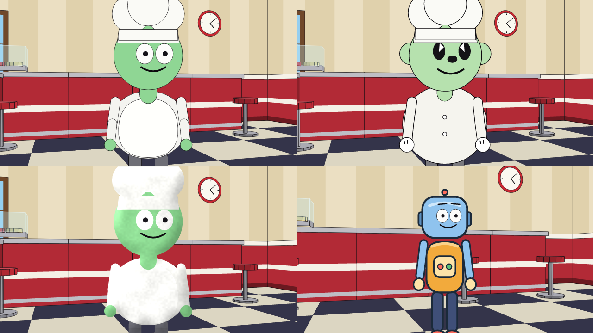
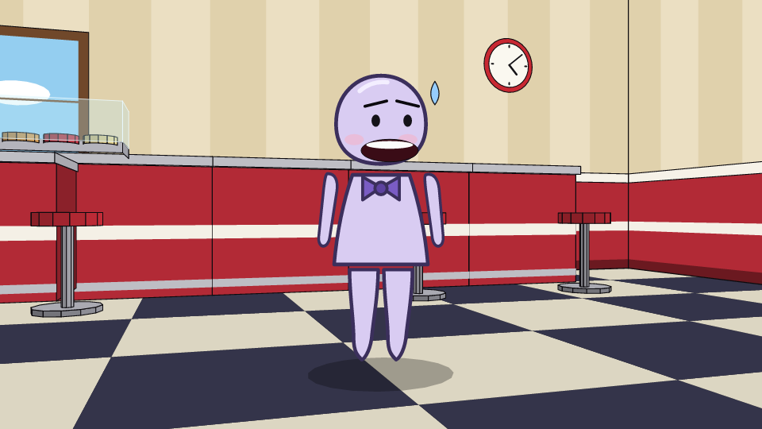

# Styles and vector characters (Phase 5)

One script, several looks. A style decides **how a character is drawn**; the script, the cameras, the timing and
the audio never change. Styles are chosen **per character**, so a paper-cutout kid can talk to a 1930s rubber-hose
cook and a robot drawn by an AI in the same shot.



*Top row: `cutout_2d` and `rubber_hose`. Bottom row: `clay` and a vector (tier B) character.*

## Choosing a style

| Where | Example | Meaning |
|---|---|---|
| Episode default | `style default: rubber_hose` | Every character without a style of its own |
| Per episode and character | `use character Blob style clay` | Overrides everything for that character in this script |
| In the character file | `style: rubber_hose` (a line of the `.onchar`) | The character's own look (the IDE builder has a Style selector) |

Order: `use ... style` > the character's own `style:` > `style default:` > `default_style` in `oneiro.toml`.
Unknown names get a suggestion (`E2301`); `toon_3d` is recognised but reported as planned (Phase 7).

```
style default: cutout_2d
use character Marta                       # paper cutout
use character Blob style rubber_hose      # 1930s noodle limbs
use character Pip                         # drawn from SVG parts (tier B)
```

The same scene rendered in all the styles is in [`examples/style_gallery`](../examples/style_gallery):
`script.onr` (hybrid) and `clay.onr` (everybody in clay).

## The styles

### `cutout_2d`
The Phase 1 paper-cutout puppet (South Park spirit): outlined pieces, view-dependent turns, lip-synced mouth.

### `rubber_hose`
Cartoons from the early 1930s:
- **noodle limbs**, no elbows or knees, drawn as outlined tubes that curve and sway;
- **pie-cut eyes**, a round nose, round ears, a slicked-back black hair cap, **white gloves** and big round shoes;
- a **bouncing body** that squashes and stretches to a 2 Hz beat (and with speech);
- the **"boil"**: wobble and bounce are held for two frames (12 fps), like hand-inked animation;
- the character's colors are nudged toward cream, as in old film stock.

### `clay`
A stop-motion plasticine look applied **on top of the character's own drawing** (so it works with `cutout_2d`,
`rubber_hose` and vector characters alike):
- the character is drawn without outlines into a layer and lit like a soft pillow (its blurred silhouette is the
  height map): light from the upper left, a soft glossy highlight, slightly more saturated colors;
- a **lumpy fingerprint texture that sticks to the body**, so it does not "swim" when the character moves;
- **animated "on twos"**: the pose is held for 1/12 s and the character jitters by a pixel or two per frame, as if it
  were moved by hand between exposures. The camera and the set stay smooth.

Everything is a pure function of the frame number, so renders stay byte-for-byte reproducible and parallel rendering
matches serial rendering (tested for hybrid and clay scenes).

Cost: a hybrid scene renders at ~7x real time at 1080p on 16 threads; clay adds roughly 40 % on top of the base drawing.

## Vector characters (tier B)

A character can be **drawn instead of assembled**: four SVG parts that Oneiro rigs into a puppet and animates
(walking, sitting, gestures, turning) with a procedural, **lip-synced face** on the head.

```
character Pip {
  rig: library.rigs.biped_cutout
  build { body: library.bodies.kid { height: 1.0 } }     # overall height
  parts {
    head { file: "library/parts/Pip/head.svg", height: 0.30, pivot: (0.5, 0.97) }
    body { file: "library/parts/Pip/body.svg", height: 0.33, pivot: (0.5, 0.97) }
    arm  { file: "library/parts/Pip/arm.svg",  height: 0.30, pivot: (0.5, 0.08) }
    leg  { file: "library/parts/Pip/leg.svg",  height: 0.36, pivot: (0.5, 0.04) }
    face { mode: auto, x: 0.5, y: 0.56, scale: 1 }
  }
}
```

- `height` is a **fraction of the character's total height**; the whole `viewBox` of the SVG is scaled to it.
- `pivot` is the joint the part turns around, as (x, y) from 0 to 1 inside the viewBox (top-left = (0, 0)): the neck
  or hips for head/body, the shoulder or hip for arm/leg. `file` may be left out: it defaults to
  `library/parts/<Name>/<part>.svg`.
- `face { mode: auto }` makes Oneiro draw eyes, eyebrows and the lip-synced mouth at (`x`, `y`) of the head
  (`scale` sizes them); use `mode: none` if the head SVG already includes a face.
- Turning is done like a cutout: parts are flipped toward the walking direction and compressed when seen from the
  side; seen from behind the face is not drawn. The arm and leg drawings are used for both sides.
- `clay` and `rubber_hose` can still be set on a vector character: `clay` shades it, `rubber_hose` is ignored (the
  puppet is always drawn from its parts).

### The SVG subset

`svg` (with a `viewBox`), `g`, `path` (`M L H V C S Q T A Z`, absolute and relative), `rect`, `circle`, `ellipse`,
`line`, `polyline`, `polygon`; attributes `fill`, `stroke`, `stroke-width`, `opacity`, `fill-opacity`,
`stroke-opacity`, `transform` and `style="fill:...;stroke:..."`. Limits: 200 KB, 600 shapes, 30,000 path segments.

**Not allowed**, on purpose: scripts, images, `use`, external references, CSS, gradients/patterns (`url(...)`),
filters, masks, clip paths, text, `on...` handlers. Files must live inside the project (no absolute paths or `..`).
An SVG from an AI or from the internet therefore cannot run code or read your disk.

### What the engine checks (so an AI can fix its own drawings)

| Code | Problem |
|---|---|
| E1110 | unknown part, part not a block, bad `face` mode |
| E1112 / E1113 | height outside 0.05-1.0; a part is missing (all of head, body, arm, leg are required) |
| E1115 | file missing, or outside the project |
| E1116 | invalid or unsupported SVG (with the exact reason: `<script> is not supported`, `gradients ... not supported`, ...) |
| E1117 | the drawing spills outside its viewBox, uses less than 50 % of it, is extremely narrow, limbs with a wide viewBox, pivot outside 0..1 |
| E1118 | (AI flow) a part's SVG block is missing from the reply |

### AI-drawn characters

- **IDE:** AI tab > *Design a character* > tick *Draw it as vector parts (SVG)*. The model answers with the character and
  four SVGs; the engine validates them and sends every problem back for a retry (the usual rounds limit). **Save to the
  library and open** writes the files and opens the character in the builder.
- **CLI:** `oneiro ai <project> "a shy robot with antennae" --character --svg [--apply]`.
- **MCP:** the `write_character_parts` tool takes the `character` source and the four SVGs, validates them and saves
  them; `get_guide` includes the format. Agents can then call `render_still` to look at the result and iterate.



*`Wisp` (in `examples/style_gallery`): one request to Claude Code through the `claude-cli` bridge, valid on the first round (about 10 s); the face and the lip-sync are Oneiro's.*

The model never gets the last word: nothing is saved unless every part passes the checks above, and the saved files
are always placed under `library/parts/<Name>/`, whatever paths the model wrote.

## What is not here yet

- `toon_3d` (Phase 7) and `.onstyle` files for user-defined styles.
- Style-specific sets and props: the diner is drawn the same way in every style (only characters change).
- A vector character has one pose per part: arms are rigid (no elbow bend) and legs do not fold when sitting
  (they rotate).
- In the IDE viewport, clay characters are shaded but not "on twos" while you drag or puppeteer them (exports are).
- Tier C (the hybrid cutter, Phase 6) is the next character path.
