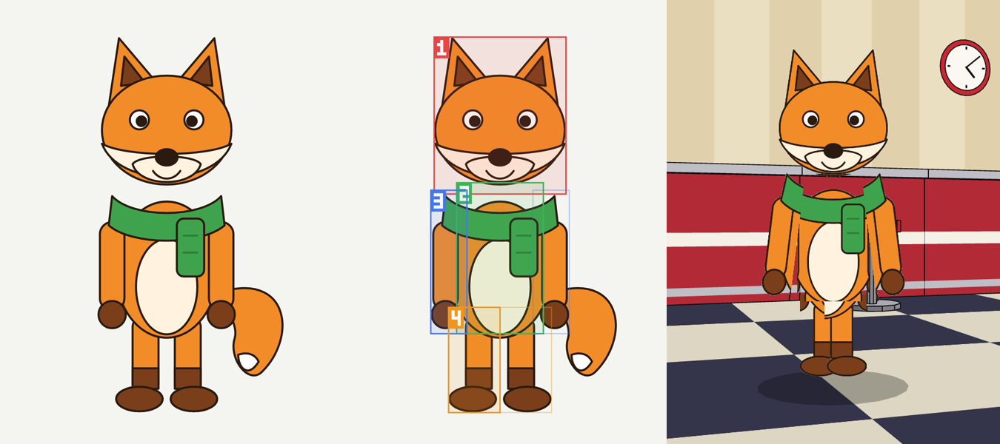
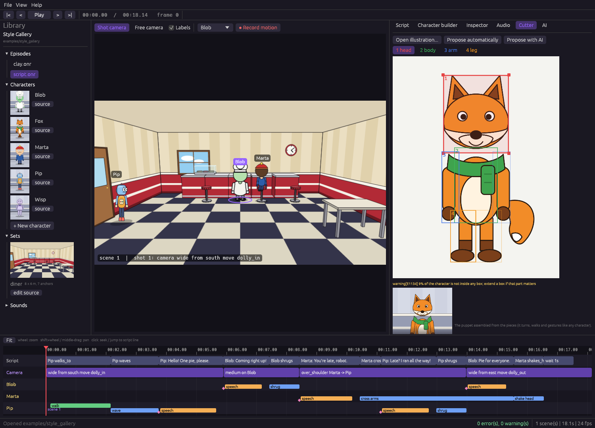

# The hybrid cutter (Phase 6)

Turns **an illustration of a character into a character you can animate**, with a person and an AI cooperating and
the engine acting as judge. The result is a normal `.onchar`: it walks, sits, gestures, turns, works in every style
(`clay`, `rubber_hose`...) and in any scene.



*Left to right: the illustration (an SVG drawn by Claude and rasterized), the four boxes Oneiro found (1 head, 2 body,
3 arm, 4 leg; the faint boxes are the mirrored right arm and leg) and the resulting character waving in the diner.*

## What it expects

One character, seen **from the front, standing, arms hanging at the sides**, on a **plain background** (or a PNG with
transparency). PNG is read directly; jpg, webp, bmp and gif go through `ffmpeg`. The right arm and the right leg are
the mirror image of the left ones (the ones on the left of the picture), so one drawing of each is enough.

## How it works

1. **Mask.** The backdrop color is learned from the border of the image and flood-filled away from the edges (colors
   inside the character that match it are kept; a head floating apart from the body is kept). A transparent PNG uses its own
   alpha. Fails with a clear message if no character is found or the background cannot be separated.
2. **Layout.** Four boxes (head, body, arm, leg) in normalized coordinates. Proposed by a **heuristic** (neck = the
   narrowest row under the head, hips = where the legs separate, torso = the central run of the body rows, the symmetry
   axis = the center of the head, so a tail does not shift it) or by a **vision model**, and fixed by a person.
3. **Validator** (plain-language problems, codes `E1130`-`E1137`):
   box outside the image or too small (`E1130`), box with none of the character (`E1131`), wrong order head/body/leg or
   too much overlap (`E1132`), arm or leg not on the left side, body off-center (`E1133`), more than 12 % of the
   character outside every box (`E1134`, warning above 5 %), character cut off by the image edge (`E1135`), limb boxes
   wider than tall (`E1136`), and a body box that reaches past the arms (`E1137`: a tail or the arms themselves would push
   the puppet's arms away from the trunk).
4. **Cut.** Each piece is the box ∩ mask (with a soft edge), trimmed, scaled to at most 512 px, with its **pivot** found
   from its own silhouette (neck, hips, shoulder, hip) and its **height as a fraction of the character's height**.
5. **Save.** `library/parts/<Name>/{head,body,arm,leg}.png` and `library/characters/<Name>.onchar`: the same `parts`
   block as vector characters, with `.png` files, and `face { mode: none }` because the illustration already has its
   own face.

Raster parts are rendered like vector ones (scaled to their height, rotated at their pivot, flipped/compressed to turn,
tinted by night scenes), with the right arm and leg drawn as the mirror image of the left ones while the character faces
the camera.

## Using it

**IDE: Cutter tab.** *Open illustration...* proposes the boxes. *Propose with AI* asks the provider of the AI tab (it
needs a model that can see: Claude Code CLI, Codex CLI, the Anthropic API...). Drag a box (select 1-4 first, or click
inside it): corners resize, the inside moves. The checker updates live, the assembled puppet is shown below, and
*Create character* is enabled when there are no errors.



**CLI.**

```
oneiro cut fox.png my_project --name Fox                       # automatic boxes, validated, saved
oneiro cut fox.png my_project --name Fox --ai --provider claude-cli
oneiro cut fox.png --overlay boxes.png                         # only look: prints the layout JSON and problems
oneiro cut fox.png my_project --name Fox --layout boxes.json --height 1.2 --style clay
```

The layout is `{"head": [x0, y0, x1, y1], "body": [...], "arm": [...], "leg": [...]}` with coordinates from 0 to 1.

**MCP.** `propose_cut` returns the picture with the numbered boxes, the layout JSON and the validator's verdict (pass
`layout` to check boxes you edited); `cut_character` validates again and saves. An agent can loop: propose, look at
the picture, correct the JSON, cut, `render_still`.

### The AI loop

The model gets the picture and a rough automatic guess, answers with JSON only, and the engine answers back with the
problems and **the same picture with the numbered boxes drawn on it**, until the layout has no errors (the usual rounds
limit; the last proposal is kept and can be fixed by dragging). For `claude-cli` the bridge now lets Claude Code read
the picture with its `Read` tool only (every other tool stays off, in a scratch folder).

## What was verified

- Illustrations drawn by the engine itself (Marta, Blob, Pip, on flat and transparent backgrounds) and **a fox drawn by
  Claude** (an SVG with a floating head and a tail, rasterized): masks, proposals, validation, cut, render, night scenes,
  clay on top. The heuristic produced a valid cut of the fox; the model's first proposal (round 1) put the tail inside the
  body box and the new `E1137` rule sent it back; round 2 was accepted.
- 12 tests in `oneiro-cutter`, 3 AI-loop and MCP tests (mock provider and tools), the box-dragging maths in the IDE,
  and the real `claude-cli` bridge with vision.

## Limits (honest)

- Front-facing, symmetric characters only. Side views, turnarounds and poses with raised arms are not handled.
- The cut pieces are flat: where an arm used to cover the body, the torso piece contains the arm's pixels, so when an
  arm swings away a thin sliver of the arm color can remain on the trunk; the waist can show a straight cut. Tighter or
  wider boxes (by dragging) fix most cases; there is no inpainting of hidden areas yet.
- A **tail, wings or accessories** have no box of their own: they stay uncovered (a warning) unless a box includes them,
  and a body box that includes them is rejected (`E1137`).
- The face of the illustration is static: the mouth does not move with the audio. (A character drawn from SVG with
  `face { mode: auto }` is lip-synced.)
- Quality of the AI's boxes varies: in our run the automatic proposal was better than the model's first answer, and the
  model needed the validator to get there. The person has the last word.
- Arms and legs are rigid pieces (no elbow or knee), like vector characters.

## Architecture

- `oneiro-cutter`: `Image`, `extract_mask`, `Layout`/`propose`/`validate`, `overlay::draw`, `cut`, `write_character`
  (no AI inside).
- `oneiro-ai::cutter_ai`: the vision loop (`propose_with_ai`); the MCP tools live in `oneiro-ai::tools`.
- `oneiro-core::raster`: PNG parts (`SvgPart.raster`); `oneiro-render::puppet` draws them.
- `oneiro-ide::cutter`: the tab.
