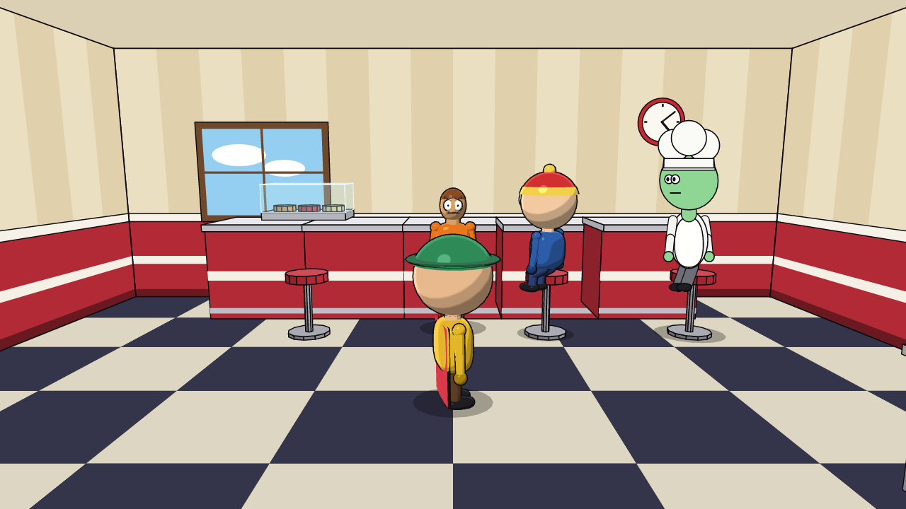

# The 3D toon style and physics (Phase 7)

`toon_3d` draws a character as **real 3D geometry** with cartoon shading: flat color bands, a small toon highlight,
a rim light and ink outlines. It is one more per-character style: it mixes in the same scene with cutout, rubber hose,
clay and vector characters, and the set, cameras, audio and script do not change.

```
style default: toon_3d                     # everybody
use character Blob style cutout_2d         # or choose per character
```

Or in the character file: `style: toon_3d`. The skeleton, proportions, wardrobe, colors, expressions, gaze and lip-sync
are the same as in every other style, so a character you already have just works.

## What you get

- **Real geometry** built every frame from the character's definition: a superellipsoid head (round, square or oval),
  a rounded torso, capsule limbs with elbows and knees, shoes, neck, hair, hats (beanie, chef hat, green and yellow
  hats) and scarf, apron...
- **Turning is real**: walk past the camera, turn around, look at someone: the head follows its gaze target. Legs and
  arms swing in depth (forward and back), thighs go forward when sitting, and the upper body sways a little.
- **A 3D face**: eyes with pupils that follow the gaze, blinking, eyebrows, and a mouth shaped by the same viseme
  table as the 2D styles (so it lip-syncs to any voice file).
- **Cel shading**: three light bands with soft edges, a toon highlight, a rim light; the light always comes from the
  upper left toward the viewer, whatever the camera does. Night scenes tint it like they tint the 2D characters.
- **Ink outlines** (inverted hull) at a constant width in pixels, like the other styles' outlines.
- **Exact registration with the set**: each character is rendered into its own layer with a camera identical to the one
  of the 2D set, and layers are composited in depth order with the props.



### Physics: a cloth cape and a springy tail

```
character Hero {
  style: toon_3d
  toon3d { cape: #C02030 }                 # a cloth cape (hangs from the shoulders)
  ...
}
character Squirrel {
  style: toon_3d
  toon3d { tail: #E0782A }                 # a tail on springs (also fine together with a cape)
  ...
}
```

The simulation is a Verlet cloth (a 9 x 8 grid with structural and bending constraints) for the cape and a chain of 7
points on soft springs for the tail. The cape collides with the torso and the floor and trails behind when the
character runs; the tail holds its shape and lags behind moves.

**Frames stay a pure function of time.** Physics has history, so it is simulated *once*, in order, when the script is
compiled (120 steps per second, stored at 60 per second and interpolated). Rendering only reads the result, which keeps
parallel rendering and re-renders exact. Only characters with `toon3d` extras and the 3D style pay for it, and the IDE
re-simulates when you edit (a few milliseconds for a 20 s scene).

## The two renderers

| | CPU | GPU (wgpu) |
|---|---|---|
| Needs | nothing | a graphics adapter (Vulkan / DirectX 12 / Metal) |
| Result | identical on every machine | the same look; tiny differences between drivers |
| Anti-aliasing | 2x2 supersampling | 4x multisampling |
| Speed (this project's demo, 1080p, 16 threads) | 1.6-2.3x real time | 2.5x real time |
| Speed with a single thread (720p) | 0.7x real time | 2.0x real time |

`Auto` (the default) uses the GPU when one is found and falls back to the CPU rasterizer otherwise (and if anything
goes wrong with the GPU). Force one with `--3d cpu|gpu|auto` in `oneiro render` or the `ONEIRO_3D` environment variable.
Use `cpu` when you need renders that are bit-for-bit the same on every machine. The GPU path is headless (it never opens
a window) and is tested to agree with the CPU one (same silhouettes, mean colour difference under 12/255 on a character
with a cape).

## Limits (honest)

- Only characters built from library blocks (tier A) become real 3D. A **vector (SVG) or cut-out (PNG) character** asked
  to be `toon_3d` is drawn as its flat puppet, because it has no depth to build.
- The decorative set and props stay 2D (drawn by the usual projected polygons); a 3D character is composited in front of
  or behind them by depth order, but it does **not** cast or receive 3D shadows from them (a soft contact shadow is
  drawn on the floor as for every style).
- Physics is limited to the cape and the tail. There is no hair, clothing-on-body cloth, rigid-body props or ragdolls.
  The cape collides with the torso and floor only (not with the legs, chairs or other characters).
- The mesh is procedural and simple (about 7-9k triangles per character): a toy-like look, not a sculpted model; no
  imported meshes or textures yet.
- Characters with a very long cape or fast spins can look stiff at 24 fps; `STORE_HZ` is 60.

## Using it

```
oneiro render examples/toon3d_demo -o out/toon3d.mp4                  # 3D characters, cape, tail, voices, music
oneiro render examples/toon3d_demo --3d cpu --preview                 # force the software renderer
```

In the IDE, the character builder's *Style* selector has `toon_3d` and, when chosen, a cape and a tail switch with a
colour each. `oneiro vocab` and the AI guide list the style, and agents can write `toon3d { ... }` in characters.

## Architecture

- `oneiro-core::pose` — the skeleton pose shared by every non-block style and the 3D builder.
- `oneiro-core::physics` — the cape and tail simulation, attached to each actor when a scene is compiled.
- `oneiro-toon3d` — `mesh` (superellipsoids, capsules, caps, cloth sheets), `build` (character -> mesh), `raster`
  (the CPU backend and the reference shading function), `gpu` (the wgpu backend with the same shading in WGSL).
- `oneiro-render` — draws the layer with the 2D set's camera and composites it.
